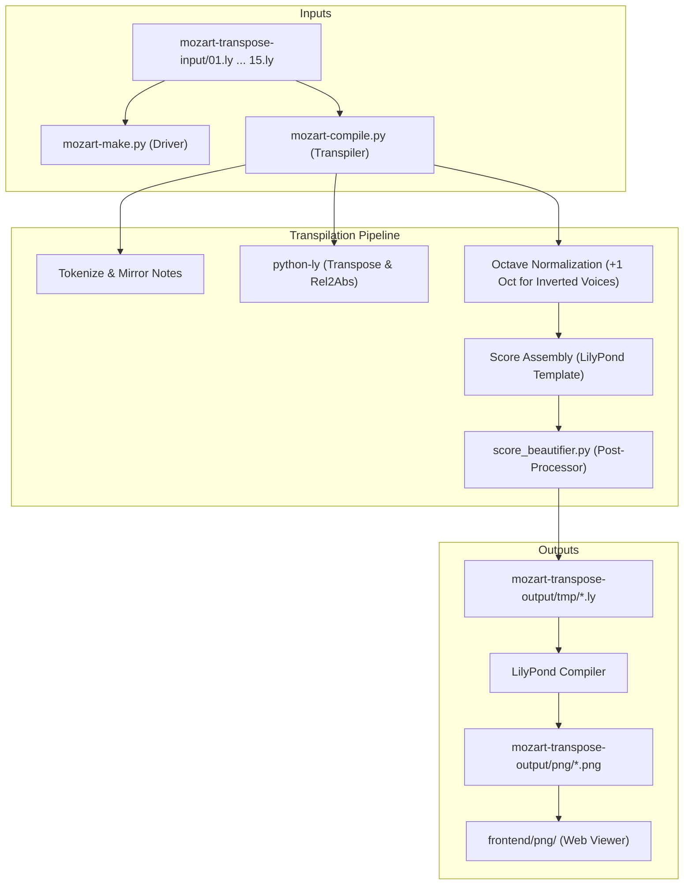

# Agents Guide & Knowledge Base: Bach in the Mirror (`bach-in-the-mirror`)

Welcome to the **Bach in the Mirror** project. This document serves as the single source of truth for all AI agents and developers collaborating on this codebase.

---

## 1. Vision & Architectural Roadmap

### Background
**Bach in the Mirror** was originally hand-crafted by Benjamin Pritchard ([Kundalini Software](https://www.kundalinisoftware.com)) as a specialized application of the Mozart Transposition Engine. Its goal is to take Johann Sebastian Bach's 15 Two-Part Inventions (BWV 772–786) and transpile them into symmetrically inverted scores in all 12 musical keys and across multiple mirroring modes.

This project is a foundational reference and score-generation engine for [pianomirror.org](file:///Users/benjamin/websites/pianomirror.org/agents.md), the browser-based WebMIDI piano education platform centered around bilateral keyboard symmetry.

### The Musical Concept: Symmetrical Inversion
The human body has bilateral symmetry: the hands are mirror images of each other (thumbs inward, pinkies outward). The acoustic piano keyboard, however, is linear (frequencies ascend toward the right for both hands).

In **Symmetrical Inversion**:
- The keyboard is reflected across an axis of symmetry (typically **D** or **A♭/G♯**, where the black and white piano key patterns are naturally symmetrical).
- When one hand ascends, the other hand descends in exact mirror-image pitch and physical motion.
- Fingerings between hands become **1:1 identical** (Thumb mirrors Thumb, Index mirrors Index, etc.).
- Practicing inverted scores unlocks motor balance, neuro-muscular synchronization across hemispheres, and geometric insights into musical intervals.

### The Masterpiece Evolution: MusicXML Architecture
The initial release used a prototype tokenizer and regex-based string manipulation pipeline specifically targeted at LilyPond text files.

Our long-term architectural goal is to convert this engine into a **modular, extensible masterpiece**:
1. **MusicXML First-Class Support**: Native parsing, transposition, inversion, and serialization of MusicXML scores (`.musicxml` / `.xml`), enabling compatibility with standard score editors (MuseScore, Finale, Sibelius) and web notation renderers (OpenSheetMusicDisplay, OSMD, Verovio).
2. **Robust Music Representation (AST / Semantic Model)**: Replace character-level token splitting with a strongly typed musical object model (Parts, Measures, Voices, Notes, Rests, Chords, Clefs, Pitch Intervals, Accidental Alterations, Time Signatures).
3. **Dual Backend Emitters**: Support emitting both clean **MusicXML** and beautiful **LilyPond** markup.
4. **Clean Driver Architecture**: Modernize `mozart-make.py` with asynchronous multiprocessing, structured logging, progress indicators, and robust caching.

---

## 2. Standing Rules for All Agents

Every agent working on this codebase must adhere strictly to these operational guidelines:

1. **ALWAYS Update `changelog.md`**:
   - Every change, bug fix, feature, or environment update must be logged in [changelog.md](file:///Users/benjamin/websites/pianomirror.org/ref/bach-in-mirror/bach-in-the-mirror/changelog.md).
   - Keep newest entries at the top under semantic versioning.

2. **Isolate Python Environments in `.venv/`**:
   - All Python dependencies (including `python-ly`) must live inside the local `.venv/` virtual environment.
   - Never install packages into the global macOS / Homebrew environment.
   - Always verify `.venv/`, `__pycache__/`, and other ephemeral artifacts remain ignored in [.gitignore](file:///Users/benjamin/websites/pianomirror.org/ref/bach-in-mirror/bach-in-the-mirror/.gitignore).

3. **Dynamic Executable Resolution**:
   - Never hardcode absolute system paths (such as `/usr/bin/ly` or `/usr/bin/python3`).
   - Use `sys.executable`, `shutil.which()`, or `sys.prefix` to resolve binaries within the active Python virtual environment across macOS, Linux, and other environments.

4. **Preserve Musical Correctness**:
   - Ensure pitch inversion math strictly maintains symmetry across axes (D4 = 50 MIDI note number, split point 56 for G#4/Ab4, etc.).
   - Preserve octave transposition and clef handling so inverted scores are comfortably playable on standard 88-key pianos.

---

## 3. Current Architecture & Directory Structure



### Key Files & Directories

- **[mozart-compile.py](file:///Users/benjamin/websites/pianomirror.org/ref/bach-in-mirror/bach-in-the-mirror/mozart-compile.py)**:
  Core transpiler. Parses a two-voice input score with custom header metadata, inverts note pitch tokens across the symmetry axis, invokes `python-ly` to transpose keys and notes, applies octave normalization to inverted voices, and generates a formatted LilyPond score.
- **[score_beautifier.py](file:///Users/benjamin/websites/pianomirror.org/ref/bach-in-mirror/bach-in-the-mirror/score_beautifier.py)**:
  Score post-processor. Strips erratic measure-by-measure `\ottava` statements, removes duplicate ottavas, and ensures optimal piano register layout.
- **[mozart-make.py](file:///Users/benjamin/websites/pianomirror.org/ref/bach-in-mirror/bach-in-the-mirror/mozart-make.py)**:
  Parallel driver script designed to batch process input files across 12 transpositions and mirroring modes, run `score_beautifier`, then invoke `lilypond --png` to generate score sheet images.
- **[mozart-transpose-input/](file:///Users/benjamin/websites/pianomirror.org/ref/bach-in-mirror/bach-in-the-mirror/mozart-transpose-input/)**:
  Input scores for Bach Inventions 1 through 15. Formatted with 5-line metadata headers (Composer, Title, Opus, Key, Time Signature) followed by LilyPond `voiceone` and `voicetwo` definitions.
- **[mozart-transpose-output/](file:///Users/benjamin/websites/pianomirror.org/ref/bach-in-mirror/bach-in-the-mirror/mozart-transpose-output/)**:
  Target directory containing intermediate `.ly` files in `tmp/` and rendered score images in `png/`.
- **[frontend/](file:///Users/benjamin/websites/pianomirror.org/ref/bach-in-mirror/bach-in-the-mirror/frontend/)**:
  HTML and JavaScript frontend for viewing generated inverted scores with synchronized playback.
- **[changelog.md](file:///Users/benjamin/websites/pianomirror.org/ref/bach-in-mirror/bach-in-the-mirror/changelog.md)**:
  Chronological log of modifications, fixes, and architecture milestones.

---

## 4. Virtual Environment & Quick Start

### Setup & Activation
```bash
# Inside ref/bach-in-mirror/bach-in-the-mirror
python3 -m venv .venv
source .venv/bin/activate
pip install python-ly
```

### Running the Transpiler Directly
```bash
# Default test run (uses mozart-transpose-input/01.ly)
.venv/bin/python mozart-compile.py

# Custom parameters
.venv/bin/python mozart-compile.py --transpose=5 --split=56 --mode=1 \
    mozart-transpose-input/01.ly \
    mozart-transpose-output/tmp/0_01_3_6.ly
```

### Compiling Scores with LilyPond
```bash
lilypond --png -o mozart-transpose-output/png/01_sample mozart-transpose-output/tmp/0_01_3_6.ly
```

