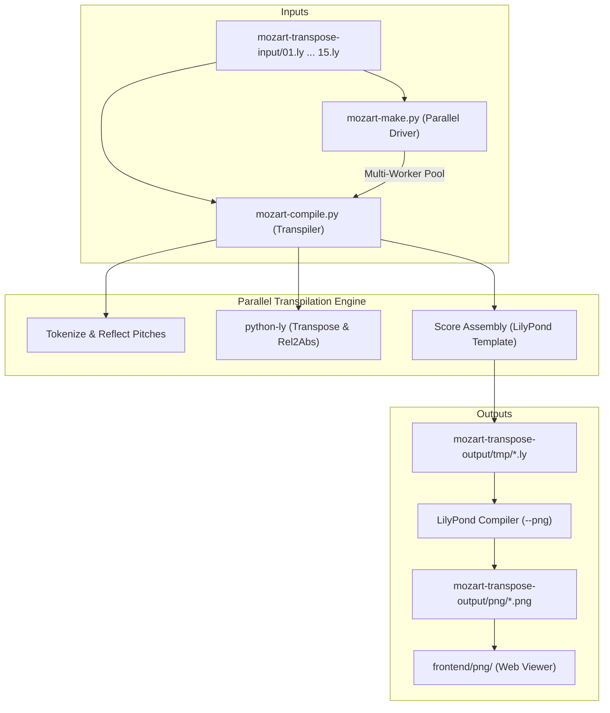

# Bach in the Mirror (`bach-in-the-mirror`)

[](https://github.com/BenjaminPritchard/bach-in-the-mirror)

**Bach in the Mirror** is a specialized score-generation and transpilation engine created by Benjamin Pritchard ([Kundalini Software](https://www.kundalinisoftware.com)). It takes Johann Sebastian Bach's 15 Two-Part Inventions (BWV 772–786) and transposes and symmetrically inverts them across all 12 musical keys and multiple mirroring modes.

This project serves as a foundational engine for [pianomirror.org](https://pianomirror.org), exploring bilateral symmetry in piano pedagogy.

---

## 1. The Musical Concept: Symmetrical Inversion

The human body possesses bilateral symmetry: the hands are physical mirror images of one another (thumbs inward, pinkies outward). However, the acoustic piano keyboard is linear (pitches ascend toward the right for both hands). As a consequence, traditional piano technique requires contradictory finger movements between the hands for identical musical shapes.

In **Symmetrical Inversion**:
- The keyboard reflects across a central axis of symmetry (typically **D** or **A♭/G♯**, where the black and white piano key patterns are naturally symmetrical).
- When the right hand ascends, the left hand descends in exact mirror-image pitch and physical motion.
- Fingerings between the hands become **1:1 identical** (Thumb mirrors Thumb, Index mirrors Index, etc.).
- Practicing inverted scores unlocks motor balance, neuro-muscular synchronization across hemispheres, and geometric insights into musical intervals.

---

## 2. Mirroring Modes

The engine supports 4 distinct mirroring modes via the `--modes` / `-m` parameter (**all 4 modes are generated by default**):

| Mode | Name | Description |
| :---: | :--- | :--- |
| **`0`** | **No Mirroring** | Standard transposition only. Both voices retain their original pitch contour without reflection. |
| **`1`** | **Left Hand Ascending** | Voice 1 (RH) is transposed normally; **Voice 2 (LH) is generated as the exact physical mirror of Voice 1** across the symmetry axis. |
| **`2`** | **Right Hand Descending** | Voice 1 (RH) is generated as the **physical mirror of Voice 2 (LH)**. |
| **`3`** | **Mirror Image** | **Both voices are inverted** across the axis, turning the entire score geometrically upside down. |

*(Modes `4` and `5` are reserved for future Call and Response modes).*

---

## 3. Architecture & Project Layout



### Key Files
- **[`mozart-compile.py`](mozart-compile.py)**: Core transpiler. Parses custom 5-line metadata headers, reflects pitch tokens across the symmetry split axis, calls `python-ly` for key transposition, and outputs formatted LilyPond files.
- **[`mozart-make.py`](mozart-make.py)**: Multi-worker parallel build driver (`-j` / `--jobs`, `--modes`, `-f`, `--all`). Orchestrates batch transpilation and GNU LilyPond score image rendering.
- **[`build.sh`](build.sh)**: Shell driver script. Nukes temporary workspaces, resolves `.venv/bin/python`, runs `mozart-make.py`, and syncs output images.
- **[`Makefile`](Makefile)**: Makefile wrapper supporting standard `make` workflows with dynamic CPU core detection.
- **[`mozart-transpose-input/`](mozart-transpose-input/)**: Source LilyPond input files for Bach Inventions 1 through 15.
- **[`mozart-transpose-output/`](mozart-transpose-output/)**: Generated intermediate `.ly` files in `tmp/` and rendered `.png` scores in `png/`.
- **[`frontend/`](frontend/)**: Browser interface for viewing generated scores with synchronized audio.

---

## 4. Setup & Quick Start

### Prerequisites
- **Python 3.10+**
- **GNU LilyPond** (`brew install lilypond` on macOS, or `apt install lilypond` on Linux)

### Environment Setup
```bash
# Clone the repository
git clone https://github.com/BenjaminPritchard/bach-in-the-mirror.git
cd bach-in-the-mirror

# Create and activate local virtual environment
python3 -m venv .venv
source .venv/bin/activate

# Install python-ly
pip install python-ly
```

---

## 5. Building the Scores

### Method 1: Using `make` (Recommended)
The `Makefile` automatically detects available CPU cores (`getconf` / `nproc` / `sysctl`):

```bash
# Build all 15 inventions using all CPU cores
make

# Build with a specific number of parallel worker jobs
make -j14

# Build a single invention (e.g. Invention 1)
make 01

# Clean temporary files and rendered scores
make clean
```

### Method 2: Using `build.sh`
```bash
# Build all inventions with auto-detected cores
./build.sh

# Build Invention 01 with 8 workers
./build.sh -j 8 01

# Force rebuild mode 1 (Left Hand Ascending mirror)
./build.sh -f -m 1 01
```

### Method 3: Using `mozart-make.py` Directly
```bash
# Run with virtual environment interpreter
.venv/bin/python mozart-make.py -j 6 --all

# Generate mirror mode 1 for Inventions 01 and 02
.venv/bin/python mozart-make.py -m 1 01 02
```

### Method 4: Transpiling a Single File Directly
```bash
.venv/bin/python mozart-compile.py --transpose=5 --split=56 --mode=1 \
    mozart-transpose-input/01.ly \
    mozart-transpose-output/tmp/0_01_3_6.ly
```

---

## 6. Multi-Core Performance Benchmarks

Below are empirical benchmarks measured on an Apple Silicon 6-core processor rebuilding Invention 01 (12 transpositions, full LilyPond PNG rendering):

| Workers (`-j`) | Execution Time | Speedup | Throughput | Notes |
| :---: | :---: | :---: | :---: | :--- |
| **1** | **7.77 s** | 1.00× | 1.54 scores/s | Sequential baseline |
| **2** | **5.48 s** | 1.42× | 2.19 scores/s | Immediate concurrency gain |
| **3** | **4.16 s** | 1.87× | 2.88 scores/s | Steady scaling |
| **4** | **3.57 s** | 2.18× | 3.37 scores/s | 2.2× faster |
| **6** | **2.98 s** | **2.61×** | **4.02 scores/s** | **Hardware sweet spot (6 physical cores)** |
| **14** | **3.38 s** | 2.30× | 3.56 scores/s | Context switching on 6-core machine (scales to 14 on 14-core workstation) |

---

## 7. Author & Links

**Benjamin Pritchard** / Kundalini Software  
- Website: [kundalinisoftware.com](https://www.kundalinisoftware.com)
- Bach in the Mirror Demo: [kundalinisoftware.com/bach-in-the-mirror](https://kundalinisoftware.com/bach-in-the-mirror/)
- Piano Mirror Platform: [pianomirror.org](https://pianomirror.org)
- Mozart Transposition Engine: [kundalinisoftware.com/mozart-transposition-engine](https://www.kundalinisoftware.com/mozart-transposition-engine/)
