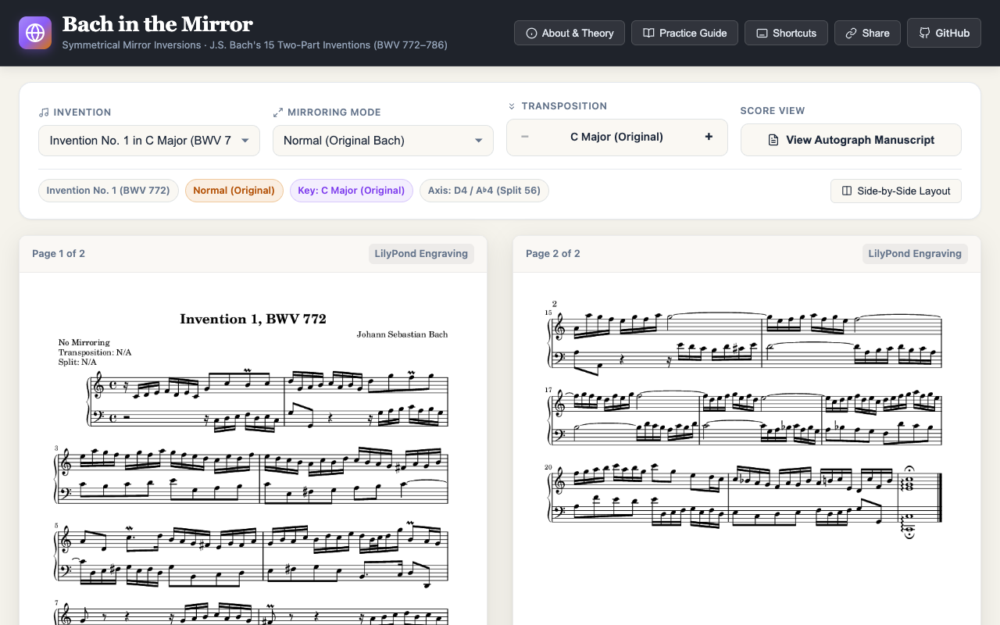
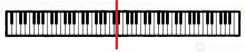
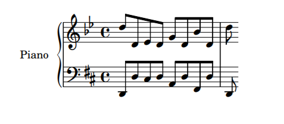
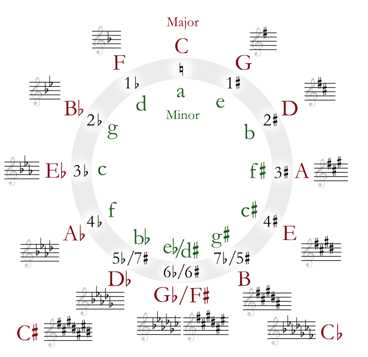
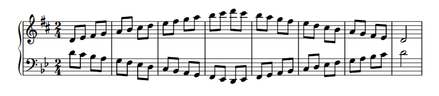
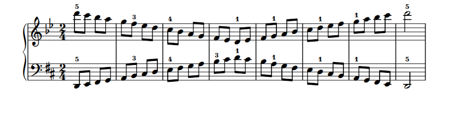
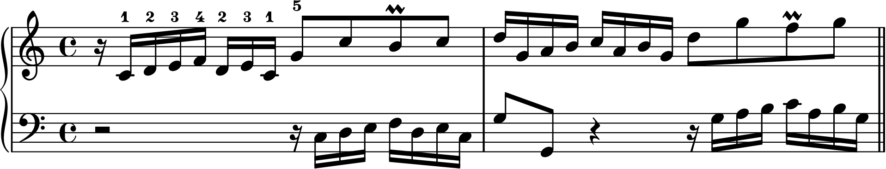
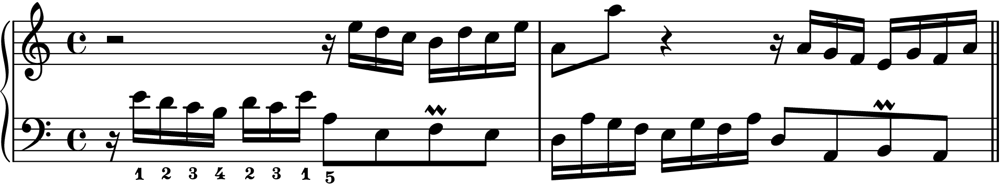
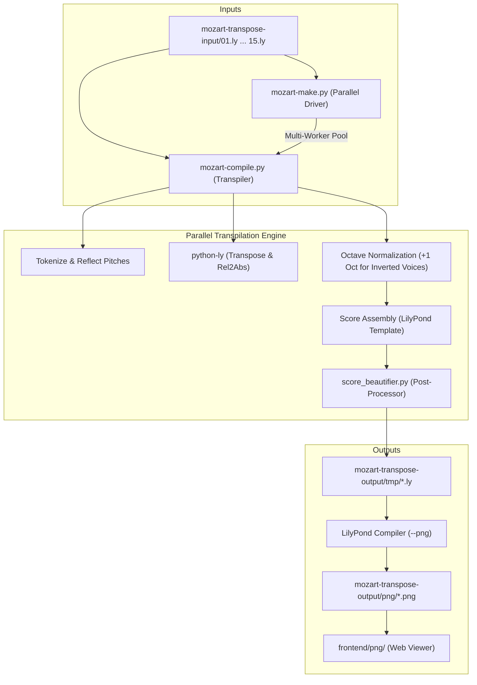

# Bach in the Mirror (`bach-in-the-mirror`)

[](https://benjaminpritchard.github.io/bach-in-the-mirror/)

> 🎹 **Live Interactive Score Viewer**: [https://benjaminpritchard.github.io/bach-in-the-mirror/](https://benjaminpritchard.github.io/bach-in-the-mirror/)

**Bach in the Mirror** is a score-generation and transpilation engine created by Benjamin Pritchard ([Kundalini Software](https://www.kundalinisoftware.com)). It takes Johann Sebastian Bach's 15 Two-Part Inventions (BWV 772–786) and transposes and symmetrically inverts them across all 12 musical keys and multiple mirroring modes.

This project serves as a foundational reference engine for [pianomirror.org](https://pianomirror.org), dedicated to exploring bilateral keyboard symmetry in piano pedagogy, neuromuscular coordination, and score analysis.

---

### Origin, Grant Support & Architectural Evolution

|  |  |
| :---: | :---: |
| **National Science Foundation (NSF)**<br>Federal Grant — *NSF I-Corps Sites Program*<br>*(University of Akron Research Foundation / Bounce Innovation Hub)* | **Burton D. Morgan Foundation**<br>Matching Grant — *Entrepreneurship & Technical Commercialization*<br>*(Northeast Ohio)* |

The initial customer discovery and technical feasibility research for the **Kundalini Piano Platform** was funded through an **NSF I-Corps (Innovation Corps) Sites** grant, administered by the **University of Akron Research Foundation (UARF)** at the Bounce Innovation Hub in Akron, Ohio (Team `SU19-004`). The federal award was matched by a grant from the **Burton D. Morgan Foundation**, which champions entrepreneurial education and technological innovation across Northeast Ohio.

- **Version 1.0 (Hand-Crafted Engine)**:  
  Originally written and hand-crafted by **Benjamin Pritchard** ([Kundalini Software](https://www.kundalinisoftware.com)) following the NSF I-Corps Sites initiative. Version 1.0 was built as a specialized prototype tokenizer and regex-based transpiler specifically targeting GNU LilyPond text files and real-time MIDI remapping for the physical Kundalini Piano hardware.
- **Version 2.0 (AI-Augmented Architecture with Google Gemini)**:  
  Created and architected by **Benjamin Pritchard** in pair programming with **Google Gemini** (specifically **Google DeepMind's Antigravity**, powered by **Gemini 2.5 Pro**). Version 2.0 rebuilt the engine into an asynchronous, multi-worker parallel pipeline (`mozart-make.py`), introduced an automated LilyPond score post-processor (`score_beautifier.py`), resolved register anomalies through octave normalization (`\transpose c c'`), implemented dynamic hardware core detection and PNG normalization, and built an accessible classical web application with one-step GitHub Pages deployment (`make deploy`).

---

## 1. Biomechanics & Neurology of Symmetrical Inversion

The human body exhibits **bilateral symmetry**: the left and right hands are physical mirror reflections of one another (thumbs point inward toward the body's midline; pinkies point outward). The motor cortex maps homologous muscle groups symmetrically across the brain hemispheres.

However, the traditional acoustic piano keyboard is **linear and asymmetrical**: pitch rises monotonically to the right for both hands. As a consequence, standard piano technique forces the pianist to learn asymmetrical physical motions for identical musical concepts:

- To play an ascending scale, the right hand expands outwards from thumb to pinky (`1-2-3-thumb under`), whereas the left hand must contract inwards (`5-4-3-2-1-finger over`).
- Symmetrical physical fingerings in both hands on a standard keyboard produce dissonant, non-congruent melodic contours.

```
          Left Hand (Anatomy)                 Right Hand (Anatomy)
      Pinky  Ring  Mid  Index  Thumb       Thumb  Index  Mid  Ring  Pinky
        5     4     3     2      1           1      2     3     4     5
        │     │     │     │      │           │      │     │     │     │
        └─────┴─────┴─────┴──────┘           └──────┴─────┴─────┴─────┘
                 ◄── Outward                      Outward ──►
```

In **Symmetrical Inversion**:
1. The keyboard reflects across a geometric axis of symmetry (typically **D** or **G♯ / A♭**).
2. When the right hand ascends, the left hand descends in **exact physical and interval mirror reflection**.
3. Fingerings between the hands become **1:1 identical** (Thumb mirrors Thumb, Index mirrors Index, Pinky mirrors Pinky).
4. Symmetrical practice activates **bilateral motor transfer** (cross-education): the motor patterns of the dominant hand immediately inform and train the non-dominant hand.

> *"Weak left hand technique? Practice in mirror image."* — Concert pianist Marc-André Hamelin has frequently demonstrated the transformative power of bilateral keyboard symmetry for left-hand technical facility and neurological balance.
> 
> *Dedicated to teacher and friend Nicholas Constantinidis.*

---

## 2. The Physical Geometry of the Keyboard

The traditional piano keyboard exhibits two natural axes of symmetry within every octave:

1. **The White Key Axis: D**  
   D is centered between the group of **two black keys** (C♯ and D♯). Moving outward by half steps yields identical black-and-white key spacing in both directions.
2. **The Black Key Axis: G♯ / A♭**  
   G♯ / A♭ is centered within the group of **three black keys** (F♯, G♯, A♯). Moving outward from G♯ likewise produces an exact physical mirror reflection.



### Semitone Reflection Table (Axis: D4 / G♯4)

The table below details the exact pitch and interval mapping across the central **D** axis (MIDI Note 50 / split point 56):

| Original Pitch | Symmetrically Inverted Pitch | Interval from D4 | Physical Key Type |
| :---: | :---: | :---: | :--- |
| **D** | **D** | $0$ semitones | Axis center (White key) |
| **C♯ / D♭** | **D♯ / E♭** | $\pm 1$ semitone | Inner black key pair |
| **C** | **E** | $\pm 2$ semitones | Adjacent white key pair |
| **B** | **F** | $\pm 3$ semitones | White key boundary |
| **A♯ / B♭** | **F♯ / G♭** | $\pm 4$ semitones | Outer black key pair |
| **A** | **G** | $\pm 5$ semitones | White key pair |
| **G♯ / A♭** | **G♯ / A♭** | $\pm 6$ semitones (Tritone) | Axis center (Black key) |
| **G** | **A** | $\pm 7$ semitones | White key pair |
| **F♯ / G♭** | **A♯ / B♭** | $\pm 8$ semitones | Outer black key pair |
| **F** | **B** | $\pm 9$ semitones | White key boundary |
| **E** | **C** | $\pm 10$ semitones | Adjacent white key pair |
| **D♯ / E♭** | **C♯ / D♭** | $\pm 11$ semitones | Inner black key pair |

### Symmetrical Chord Inversion

When a chord is played in standard form in one hand, its symmetrical reflection in the opposite hand preserves the identical physical shape, distance, and finger spacing:



In the excerpt above, the Left Hand plays a standard D Major arpeggio (`D - F♯ - A - D`), while the Right Hand plays the exact symmetrical counterpart descending from D (`D - B♭ - G - D`). The fingerings and hand positions are 100% congruent.

---

## 3. Symmetrically-Inverted Notation & The Circle of Fifths

Reading symmetrically inverted music on standard staves can present reading difficulties if written with arbitrary accidentals. To solve this, **Symmetrically-Inverted Notation** pairs a standard clef with an inverted clef whose key signature geometrically mirrors the original across the **Circle of Fifths**.



### Harmonic Accidental Reflection

Under symmetrical inversion across the D / G♯ axis:
- **Sharps reflect into flats**, and **flats reflect into sharps**.
- A key signature with $n$ sharps transforms into a key signature with $n$ flats whose accidental pattern is the exact mirror image on the staff!
- Specifically, the accidental order `F♯ - C♯ - G♯ - D♯ - A♯ - E♯` mirrors `B♭ - E♭ - A♭ - D♭ - G♭ - C♭`.

### Key Signature Correspondence Table

| Original Key | Inverted Key | Original Accidentals | Inverted Accidentals (Mirror) |
| :---: | :---: | :---: | :---: |
| **C Major / A Minor** | **C Major / A Minor** | Natural (no accidentals) | Natural (no accidentals) |
| **G Major / E Minor** | **F Major / D Minor** | $1\sharp$ (F♯) | $1\flat$ (B♭ — mirror of F♯) |
| **D Major / B Minor** | **B♭ Major / G Minor** | $2\sharp$ (F♯, C♯) | $2\flat$ (B♭, E♭ — mirrors of F♯, C♯) |
| **A Major / F♯ Minor** | **E♭ Major / C Minor** | $3\sharp$ (F♯, C♯, G♯) | $3\flat$ (B♭, E♭, A♭) |
| **E Major / C♯ Minor** | **A♭ Major / F Minor** | $4\sharp$ (F♯, C♯, G♯, D♯) | $4\flat$ (B♭, E♭, A♭, D♭) |
| **B Major / G♯ Minor** | **D♭ Major / B♭ Minor** | $5\sharp$ | $5\flat$ |
| **F♯ Major / D♯ Minor** | **G♭ Major / E♭ Minor** | $6\sharp$ | $6\flat$ |
| **D♭ Major / B♭ Minor** | **B Major / G♯ Minor** | $5\flat$ | $5\sharp$ |
| **A♭ Major / F Minor** | **E Major / C♯ Minor** | $4\flat$ | $4\sharp$ |
| **E♭ Major / C Minor** | **A Major / F♯ Minor** | $3\flat$ | $3\sharp$ |
| **B♭ Major / G Minor** | **D Major / B Minor** | $2\flat$ | $2\sharp$ |
| **F Major / D Minor** | **G Major / E Minor** | $1\flat$ (B♭) | $1\sharp$ (F♯) |

Because accidental reflections align with the Circle of Fifths, any accidental encountered in the primary voice is mirrored without cluttering the score with irregular accidentals.

---

## 4. The Mirroring Modes

The transpiler supports 4 distinct mirroring modes:

| Mode | Name | Description |
| :---: | :--- | :--- |
| **`0`** | **No Mirroring** | Standard transposition. Both voices retain their original pitch contour. |
| **`1`** | **Left Hand Ascending** | Voice 1 (RH) is standard; **Voice 2 (LH) is generated as the physical mirror of Voice 1**. |
| **`2`** | **Right Hand Descending** | Voice 2 (LH) is standard; **Voice 1 (RH) is generated as the physical mirror of Voice 2**. |
| **`3`** | **Mirror Image** | **Both voices are symmetrically inverted**, rendering the entire piece geometrically upside down. |

---

### Mode 1: Left Hand Ascending (LH Mirrors RH)

**Left Hand Ascending Mode** allows a pianist to practice right-hand material using the left hand, while playing simultaneously with both hands. The dominant right hand guides the non-dominant left hand in unison motor coordination:



- Both hands begin on **Middle D** with their respective **thumbs (Finger 1)**.
- As the right hand ascends `D - E - F♯ - G - A - B - C♯ - D`, the left hand descends symmetrically `D - C - B♭ - A - G - F - E♭ - D`.
- Both hands execute the identical finger sequence on the identical interval pattern of black and white keys.

---

### Mode 2: Right Hand Descending (RH Mirrors LH)

**Right Hand Descending Mode** is the counterpart designed to practice complex left-hand passages with the right hand. The left hand plays standard notation while the right hand acts as its mirror reflection:



---

### Mode 3: Symmetrical Inversion in Bach's Two-Part Inventions

In **Mode 3 (Mirror Image)**, the entire polyphonic texture is inverted across the symmetry axis. 

Below is an analytical comparison of the opening subject and answer in **J.S. Bach's Invention No. 1 in C Major (BWV 772, mm. 1–2)**:

#### 1. Original Score (BWV 772, mm. 1–2)


#### 2. Symmetrical Inversion (Mode 3, mm. 1–2)


#### Comparative Musical & Neuromuscular Analysis:

1. **Melodic Interval Reflection**:
   - In the **Original** (Upper staff, m. 1), Bach's motive ascends:
     $$\text{C4} \xrightarrow{+M2} \text{D4} \xrightarrow{+M2} \text{E4} \xrightarrow{+m2} \text{F4} \xrightarrow{-m3} \text{D4} \xrightarrow{+M2} \text{E4} \xrightarrow{-m3} \text{C4} \xrightarrow{+P5} \text{G4}$$
   - In the **Symmetrical Inversion** (Lower staff, m. 1), the motive reflects downward across the D axis:
     $$\text{E3} \xrightarrow{-M2} \text{D3} \xrightarrow{-M2} \text{C3} \xrightarrow{-m2} \text{B2} \xrightarrow{+m3} \text{D3} \xrightarrow{-M2} \text{C3} \xrightarrow{+m3} \text{E3} \xrightarrow{-P5} \text{A2}$$
   - Every ascending step becomes a descending step of identical interval quality; every leap is reflected with mathematical precision.

2. **1:1 Neuromuscular Fingering Invariance**:
   - Notice the fingerings annotated on both scores:
     - **Original Right Hand**: `1 - 2 - 3 - 4 - 2 - 3 - 1 - 5`
     - **Inverted Left Hand**: `1 - 2 - 3 - 4 - 2 - 3 - 1 - 5`
   - The thumb strikes the initiating key, the index, middle, and ring fingers expand in sequence, the index and middle rock across the pivot, the thumb catches the base note, and the pinky extends to the outer interval. The physiological motor commands sent from the motor cortex to both hands are **identical**.

3. **Contrapuntal Voice & Register Exchange**:
   - In the original, Voice 1 (RH) introduces the subject in m. 1; Voice 2 (LH) answers at the fifth in m. 2.
   - In Mode 3, Voice 2 (LH) introduces the inverted subject; Voice 1 (RH) provides the inverted contrapuntal answer in m. 2.
   - The engine automatically applies clef adjustment and octave normalization (`\transpose c c'`) to ensure both voices remain in comfortable, natural piano registers.

---

## 5. Architecture & Project Layout



### Key Files & Modules

- **[`mozart-compile.py`](mozart-compile.py)**: Core transpiler. Parses custom 5-line metadata headers, reflects pitch tokens across the symmetry axis, calls `python-ly` for key transposition, applies octave normalization, and formats LilyPond output.
- **[`score_beautifier.py`](score_beautifier.py)**: LilyPond score post-processor. Normalizes octaves, strips erratic measure-by-measure `\ottava` statements, cleans duplicates, and ensures optimal piano layout.
- **[`mozart-make.py`](mozart-make.py)**: High-performance parallel build driver (`-j` / `--jobs`, `--modes`, `-f`, `--all`). Orchestrates multi-process batch transpilation, beautification, and GNU LilyPond score rendering with single-page and multi-page normalization.
- **[`build.sh`](build.sh)**: Shell script helper. Cleans temporary workspaces, dynamically resolves `.venv/bin/python`, runs `mozart-make.py`, and syncs output images.
- **[`package-pages.sh`](package-pages.sh)**: Deployment packager. Packages the `frontend/` static application into an isolated `gh-pages` branch for GitHub Pages using git plumbing.
- **[`Makefile`](Makefile)**: Makefile wrapper supporting standard `make` workflows (`make`, `make 01`, `make pages`, `make deploy`).
- **[`mozart-transpose-input/`](mozart-transpose-input/)**: Source LilyPond input files for Bach Inventions 1 through 15.
- **[`mozart-transpose-output/`](mozart-transpose-output/)**: Generated intermediate `.ly` files in `tmp/` and rendered `.png` scores in `png/`.
- **[`frontend/`](frontend/)**: Modern, responsive browser interface for viewing generated scores, Bach's 1723 autograph manuscript, and transposition controls.
- **[`changelog.md`](changelog.md)**: Semantic chronological record of architectural changes, bug fixes, and milestones.

---

## 6. Setup & Quick Start

### Prerequisites
- **Python 3.10+**
- **GNU LilyPond 2.24+** (`brew install lilypond` on macOS, or `apt install lilypond` on Linux)

### Environment Setup
```bash
# Clone the repository
git clone https://github.com/BenjaminPritchard/bach-in-the-mirror.git
cd bach-in-the-mirror

# Create and activate local virtual environment
python3 -m venv .venv
source .venv/bin/activate

# Install python-ly
pip install python-ly
```

---

## 7. Building the Scores

### Method 1: Using `make` (Recommended)
The `Makefile` automatically detects available CPU cores (`getconf` / `nproc` / `sysctl`):

```bash
# Build all 15 inventions across all 12 transpositions and 4 modes using all CPU cores
make

# Build with a specific number of parallel worker jobs
make -j14

# Build a single invention (e.g. Invention 1)
make 01

# Clean temporary files and rendered scores
make clean

# Package frontend into local gh-pages branch
make pages

# Package frontend and push directly to origin gh-pages
make deploy
```

### Method 2: Using `build.sh`
```bash
# Build all inventions with auto-detected cores
./build.sh

# Build Invention 01 with 8 workers
./build.sh -j 8 01

# Force rebuild mode 1 (Left Hand Ascending mirror)
./build.sh -f -m 1 01
```

### Method 3: Using `mozart-make.py` Directly
```bash
# Run with virtual environment interpreter
.venv/bin/python mozart-make.py -j 6 --all

# Generate mirror mode 1 for Inventions 01 and 02
.venv/bin/python mozart-make.py -m 1 01 02
```

### Method 4: Transpiling a Single File Directly
```bash
.venv/bin/python mozart-compile.py --transpose=5 --split=56 --mode=1 \
    mozart-transpose-input/01.ly \
    mozart-transpose-output/tmp/0_01_3_6.ly
```

---

## 8. GitHub Pages Deployment (`github.io`)

The web application is packaged directly from `frontend/` into a dedicated `gh-pages` branch using isolated git plumbing without altering your working branch:

```bash
# Package frontend/ (all 1,522 PNG scores, autograph scans, and viewer) into gh-pages
make pages

# Or package and push in a single command
make deploy
```

### Repository Configuration:
1. Navigate to: **Settings** → **Pages** (`https://github.com/BenjaminPritchard/bach-in-the-mirror/settings/pages`)
2. Under **Build and deployment** → **Source**, select **Deploy from a branch**.
3. Select branch: **`gh-pages`** and folder: **`/ (root)`**.
4. The live site is hosted at: **[https://benjaminpritchard.github.io/bach-in-the-mirror/](https://benjaminpritchard.github.io/bach-in-the-mirror/)**

---

## 9. Multi-Core Performance Benchmarks

Below are empirical benchmarks measured on an Apple Silicon processor rebuilding Invention 01 (12 transpositions, full LilyPond PNG rendering):

| Workers (`-j`) | Execution Time | Speedup | Throughput | Notes |
| :---: | :---: | :---: | :---: | :--- |
| **1** | **7.77 s** | 1.00× | 1.54 scores/s | Sequential baseline |
| **2** | **5.48 s** | 1.42× | 2.19 scores/s | Immediate concurrency gain |
| **3** | **4.16 s** | 1.87× | 2.88 scores/s | Steady scaling |
| **4** | **3.57 s** | 2.18× | 3.37 scores/s | 2.2× faster |
| **6** | **2.98 s** | **2.61×** | **4.02 scores/s** | **Hardware sweet spot (6 physical cores)** |
| **14** | **3.38 s** | 2.30× | 3.56 scores/s | Workstation multi-threading |

---

## 10. Author & Acknowledgments

**Benjamin Pritchard** / Kundalini Software  
- Website: [kundalinisoftware.com](https://www.kundalinisoftware.com)
- Live Web Viewer: [benjaminpritchard.github.io/bach-in-the-mirror](https://benjaminpritchard.github.io/bach-in-the-mirror/)
- Piano Mirror Platform: [pianomirror.org](https://pianomirror.org)
- Mozart Transposition Engine: [kundalinisoftware.com/mozart-transposition-engine](https://www.kundalinisoftware.com/mozart-transposition-engine/)
- Bach in the Mirror Demo: [kundalinisoftware.com/bach-in-the-mirror](https://kundalinisoftware.com/bach-in-the-mirror/)

### Institutional & AI Credits
- **National Science Foundation (NSF) & I-Corps**: Initial research funded through the federal **NSF I-Corps Sites Program** (Team `SU19-004`), driving early commercialization, music pedagogy discovery, and technical feasibility.
- **University of Akron Research Foundation (UARF)**: Direct program administration, entrepreneurial guidance, and incubation via UARF at the **Bounce Innovation Hub** in Akron, Ohio.
- **Burton D. Morgan Foundation**: Matching grant funding promoting entrepreneurship and technical venture creation across Northeast Ohio.
- **Google Gemini**: Version 2.0 architecture, multi-worker parallelization, score beautification, and deployment engineering developed with **Google DeepMind's Antigravity (Gemini 2.5 Pro)**.
- **In Memoriam**: Dedicated to teacher and friend **Nicholas Constantinidis**.
